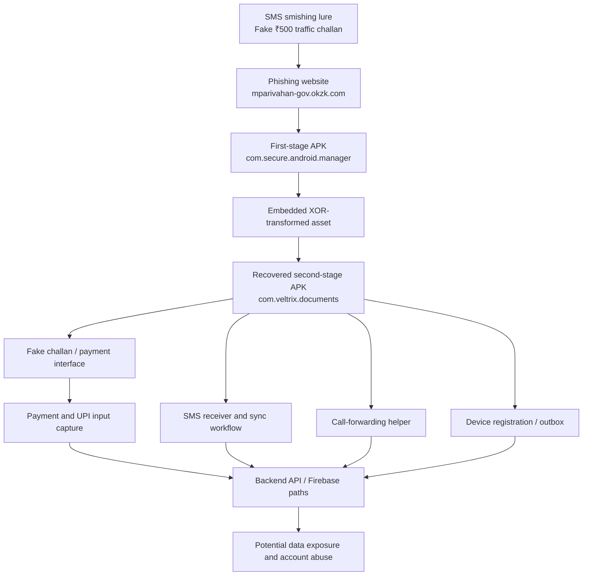

# 🚨 The ₹500 Trap: One SMS, One Fake Challan, Two Stages of Android Malware

**What looked like an ordinary traffic-fine notification led to an investigation of a suspicious Android application with SMS collection, payment-data capture and call-forwarding functionality.**

This post documents a defensive, offline investigation of a suspicious SMS, its associated phishing website and an Android APK named `NextGen_mParivahan.apk`. Static analysis identified a two-stage application structure and code associated with SMS collection, payment credential submission, remote SMS sending and call-forwarding manipulation.

> **Safety and scope:** The APK was not installed or executed. No live command-and-control (C2) infrastructure was contacted. Findings describe static code and artefacts in the submitted samples; they do not prove that a victim device was infected, that a remote server received data, or that a financial transaction occurred.

## 1. Executive summary

The investigation began with a traffic-challan-themed SMS linking to:

`hxxps://mparivahan-gov[.]okzk[.]com/4/`

The site offered:

`hxxps://mparivahan-gov[.]okzk[.]com/5/app/NextGen_mParivahan.apk`

The first-stage APK identifies itself as `com.secure.android.manager`, not the official NIC mParivahan application package. It contains installer-related code and a large embedded asset that was recovered as a second APK using XOR transformation logic found during static inspection.

The recovered application identifies as `com.veltrix.documents` and uses mParivahan-like branding. Its code includes:

- An SMS receiver and SMS synchronisation/upload workflow.
- Payment UI and payment data fields including card number, expiry, CVV and UPI PIN fields.
- API methods for submitting payment and SMS records.
- SMS sending methods using Android's `SmsManager`.
- USSD/call-forwarding helper methods and related backend API paths.
- Device registration, heartbeat and remote outbox functionality.
- Firebase integrations and a hardcoded HTTPS panel API.

The sample is assessed as **high risk and consistent with a malicious Android dropper plus a credential/data-stealing second stage**. Static analysis alone cannot confirm successful runtime execution or data exfiltration.

## 2. Initial access: the fake traffic-challan SMS

The lure impersonated a transport or traffic-challan notification and claimed that a ₹500 fine was outstanding. The SMS included a vehicle registration identifier, a reference number and a link to the suspicious host.

Personalised vehicle details, a monetary amount and an official-looking reference number are common social-engineering devices: they make a generic message feel specific and urgent.

| Element | Social-engineering purpose |
|---|---|
| Vehicle registration number | Makes the message appear personalised |
| ₹500 fine claim | Creates a reason to act quickly |
| Reference number | Adds an appearance of legitimacy |
| mParivahan wording and logos | Borrows trust from a government service |
| Non-government domain | Sends the recipient to infrastructure unrelated to the official service |
| Direct APK download | Encourages installation outside an authorised app store |

This is a **smishing** attempt: phishing delivered through SMS.

**Privacy note:** The original screenshot contained a phone number, vehicle registration and reference identifier. Those personal identifiers are intentionally redacted from this public write-up. Keep the original evidence securely; do not publish private identifiers.

## 3. Phishing website and APK delivery

### Observed URLs

```text
hxxps://mparivahan-gov[.]okzk[.]com/4/
hxxps://mparivahan-gov[.]okzk[.]com/5/app/NextGen_mParivahan.apk
```

The hostname uses the text `mparivahan-gov`, but the registrable domain is `okzk.com`. A subdomain label containing a government-service name does not make a site an official government property.

For comparison, users should independently navigate to official services rather than follow an unsolicited SMS link:

- [Official Parivahan portal](https://parivahan.gov.in/)
- [Official eChallan portal](https://echallan.parivahan.gov.in/)

Do not use the links in the suspicious SMS to verify a challan.

## 4. Stage one: APK static analysis

The downloaded APK was examined offline. It was not installed.

| Property | Extracted value |
|---|---|
| Filename | `NextGen_mParivahan.apk` |
| Package name | `com.secure.android.manager` |
| Version | `2.2.67` |
| Version code | `613` |
| Minimum SDK | `24` |
| Target SDK | `35` |
| DEX files | 1 |
| Native library | `libzykxxerb.so` |

**First-stage SHA-256:**

```text
0207073d32f5aa59d36dc686d4d885365b54789766f7ff30c7c1b361df94ec0d
```

The package identity is inconsistent with the official NIC mParivahan application identity. The first-stage manifest also includes permissions and components relevant to network access, package visibility and APK installation.

### Installer-related code

Static inspection identified:

```text
iku.vxs.rueo.installer.ApkInstallerManager
```

Related method names included:

```text
getSecretKey()
nativeXorChunk()
getTargetPackage()
getSKey()
nativeScanEnv()
```

The installer workflow references an embedded asset and an output APK filename (`update.apk`). It also references Android `PackageInstaller.Session` APIs, including session creation, writing and commit operations.

This is consistent with a dropper design: an initial application carries or prepares another application.

**Qualification:** The inspected first-stage DEX and native library showed a JNI naming mismatch. That may affect whether the native calls work in this particular build. The presence of installer code and a recovered payload is established; successful first-stage installation on a real device was not tested.

### Native anti-analysis indicators

The native library contains references to process and network inspection paths such as:

```text
/proc/self/status
/proc/self/maps
/proc/net/tcp
/proc/net/tcp6
/proc/self/task
```

It also contains strings associated with instrumentation and reverse-engineering frameworks, including Frida, Xposed, `libgadget` and `substrate`.

These strings and checks are consistent with environment inspection and anti-analysis behaviour. They do not, by themselves, prove that the application successfully evades a particular analysis environment.

### Telegram reporting code

The first-stage DEX contains a message template beginning with:

```text
[Dropper Opened]
IP:
Device:
Android:
SDK:
Pkg:
```

It constructs a Telegram Bot API `sendMessage` request using a bot endpoint and chat ID.

This is evidence of a Telegram reporting capability in the code. No Telegram message was sent or observed during this offline investigation.

## 5. Major discovery: recovery of the embedded second-stage APK

A large asset was found inside the first-stage APK:

```text
assets/ltjyqnr9y992.raw
```

| Property | Value |
|---|---|
| Asset size | 9,552,865 bytes |
| Asset SHA-256 | `6401082ca9ccbb8229c3c64aaba274d83cee395429e940af407cec096edb00fb` |
| Transformation | Repeating XOR |
| Recovered format | ZIP/APK |
| ZIP integrity | Passed |

The asset was transformed using XOR key material identified during static analysis. The recovered output began with the ZIP local-file signature (`PK\x03\x04`) and contained a separate Android manifest and four DEX files.

### Recovered second-stage metadata

| Property | Extracted value |
|---|---|
| Package name | `com.veltrix.documents` |
| Displayed branding | `Mparivahan NextGen` |
| Version | `1.0` |
| Version code | `2` |
| Minimum SDK | `23` |
| Target SDK | `36` |
| DEX files | 4 |

**Second-stage SHA-256:**

```text
bfa5c05a4b6e4429d25d1c7471d373793d0b56d1e31c6b2fa53446ec95bb5052
```

The second-stage package is distinct from the first-stage package and is not the official NIC mParivahan package identity.

## 6. Stage two: suspicious Android capabilities

### 6.1 SMS collection

A relevant component was identified:

```text
com.veltrix.documents.receiver.SmsReceiver
```

The receiver handles the Android SMS-received broadcast and processes message records. The inspected code extracts sender/address, message body and timestamp, then passes records into an SMS synchronisation workflow.

Related components and methods include:

```text
SmsReceiver
SmsV2Outbox
SmsSyncWorker
SmsRealtimeUploadWorker
FirebaseRepo.pushSmsListSuspend
```

The application declares SMS-related permissions, including `READ_SMS` and `RECEIVE_SMS`.

**Security impact:** If the relevant permissions are granted and the code executes, incoming messages may be exposed. This can include one-time verification codes and financial notifications.

### 6.2 Payment and UPI information capture

The second-stage application contains payment-related activities, including:

```text
CardPaymentActivity
PaymentMethodActivity
UpIPinActivity
VerifyingUpiPinActivity
WrongUpiPinActivity
CardFailedActivity
PaymentReceiptActivity
```

The payment model includes fields named:

```text
phone
vehicle
upiPin
upiPin1
upiPin2
cardHolderName
cardNumber
cardExpiry
cardCvv
```

The inspected code passes payment values through a submission workflow:

```text
FirebaseRepo.pushPayment()
        |
        v
FirebaseRepo.PanelApi.payment()
        |
        v
data/payments
```

This is strong static evidence of code designed to collect and submit payment-related information, including card CVV and UPI PIN fields.

**Security impact:** If a victim enters real payment details into the deceptive interface and the workflow executes, those values could be exposed to the operator. This investigation did not submit real data or verify server receipt.

### 6.3 Call-forwarding manipulation

The application contains:

```text
com.veltrix.documents.data.CallForwardingHelper
```

Methods include:

```text
getUssdCode()
sendUssd()
placeCallDirectly()
verifyState()
parseUssdResult()
```

The helper contains logic related to call-forwarding status and configuration using USSD. Related API paths include:

```text
devices/call_forwarding
devices/call_forwarding/ack
```

This is evidence of call-control functionality that could be used to redirect calls if the workflow is authorised by the operating system and successfully activated.

**Security impact:** Unauthorised call forwarding can interfere with calls intended for the device owner and may expose call-based verification or account-recovery processes.

### 6.4 SMS sending

The application declares `SEND_SMS` and contains references to:

```text
FirebaseRepo.sendSmsWithConfirmation
SmsManager.sendTextMessage
SmsManager.sendMultipartTextMessage
```

This indicates that the application contains code capable of sending SMS messages from the device. The exact remote triggers and successful use were not dynamically verified.

### 6.5 Device and account information

The application contains device-information and account-collection code, with references to device details, IP information, SIM information and account enumeration.

Contact and call-log collector code was also identified, but the corresponding permissions were not present in the inspected second-stage manifest. Successful collection of those data types is therefore **not established**.

A notification-listener service is declared. Its declaration alone does not prove that notification contents are collected or transmitted.

## 7. Command-and-control and backend indicators

A hardcoded API base URL was identified in the second-stage code:

```text
https://nexus-panel.in/api/
```

The application contains API methods and paths associated with the following functions:

| API path | Apparent purpose from code |
|---|---|
| `data/payments` | Payment information submission |
| `data/sms/batch/new` | New SMS records |
| `data/sms/batch/historical` | Historical SMS records |
| `data/emails/batch` | Email/account data |
| `devices/call_forwarding` | Call-forwarding configuration |
| `devices/call_forwarding/ack` | Call-forwarding acknowledgement |
| `outbox/pull` | Retrieve queued commands |
| `outbox/mark` | Mark command status |
| `presence/beat` | Device presence/heartbeat |
| `ping/ack` | Heartbeat acknowledgement |
| `device/installed` | Installation registration |
| `panel/config` | Configuration retrieval |

The application also integrates Firebase Firestore and Firebase Cloud Messaging.

The code indicates a backend-coordinated design. The hardcoded host may not be the only possible destination because dynamic configuration functionality is also present.

> **Operational limitation:** No DNS lookup, HTTP request, Firebase operation or C2 interaction was performed against the live infrastructure. Endpoint purpose is inferred from static method names, request models and call paths.

## 8. Reconstructed attack chain



This is a **static reconstruction of intended capabilities and code paths**, not a runtime trace of a real infected device.

## 9. MITRE ATT&CK Mobile: Tactics, Techniques and Procedures (TTPs)

The following mapping uses official MITRE ATT&CK Mobile technique names and IDs. Each mapping is tied to an observed artefact or code path. Confidence labels distinguish direct code evidence from capabilities that remain unverified.

### 9.1 TTP mapping table

| Tactic | Technique ID and official name | How it applies to this sample | Evidence level |
|---|---|---|---|
| Initial Access | [T1660 – Phishing](https://attack.mitre.org/techniques/T1660/) | SMS smishing lure impersonates a traffic-challan service and directs the recipient to a phishing site. | Strong campaign evidence |
| Initial Access | [T1476 – Deliver Malicious Application via Other Means](https://attack.mitre.org/techniques/T1476/) | The site offers a direct APK download outside an authorised application store. | Strong delivery evidence |
| Defense Evasion | [T1655 – Masquerading](https://attack.mitre.org/techniques/T1655/) | Application branding and naming imitate mParivahan / a government transport service. | Strong artefact evidence |
| Defense Evasion | [T1406 – Obfuscated Files or Information](https://attack.mitre.org/techniques/T1406/) | A second APK is concealed in a high-entropy asset and recovered through XOR transformation. | Strong artefact evidence |
| Execution / Defense Evasion | [T1575 – Native API](https://attack.mitre.org/techniques/T1575/) | The first-stage application includes a native library and JNI-related routines for transformation and environment inspection. | Code evidence; runtime uncertain |
| Persistence | [T1624.001 – Event Triggered Execution: Broadcast Receivers](https://attack.mitre.org/techniques/T1624/001/) | The second-stage manifest registers boot-related receivers that can trigger application work after device events. | Manifest/code evidence |
| Credential Access / Collection | [T1417.002 – Input Capture: GUI Input Capture](https://attack.mitre.org/techniques/T1417/002/) | Payment and UPI activities present forms that solicit card and PIN information under a misleading application identity. | Strong code/UI evidence |
| Collection | [T1636.004 – Protected User Data: SMS Messages](https://attack.mitre.org/techniques/T1636/004/) | `SmsReceiver` processes incoming SMS data and passes records to synchronisation/upload code. | Strong code evidence |
| Collection | [T1636.005 – Protected User Data: Accounts](https://attack.mitre.org/techniques/T1636/005/) | AccountManager-based account enumeration code is present. Actual account data collection is not confirmed. | Potential / code evidence |
| Collection | [T1517 – Access Notifications](https://attack.mitre.org/techniques/T1517/) | A notification-listener service is declared. The inspected evidence does not establish notification-content collection or exfiltration. | Potential only |
| Collection / Impact / Command and Control | [T1616 – Call Control](https://attack.mitre.org/techniques/T1616/) | USSD/call-forwarding helper code and backend paths support call-forwarding configuration. Successful redirection was not tested. | Strong capability evidence |
| Impact | [T1582 – SMS Control](https://attack.mitre.org/techniques/T1582/) | `SEND_SMS` and `SmsManager` methods provide functionality to send SMS messages from the device. | Code evidence |
| Command and Control | [T1437.001 – Application Layer Protocol: Web Protocols](https://attack.mitre.org/techniques/T1437/001/) | HTTPS API methods and Firebase messaging integrations provide web-protocol communication paths for backend coordination. | Strong code evidence |
| Exfiltration | [T1646 – Exfiltration Over C2 Channel](https://attack.mitre.org/techniques/T1646/) | SMS and payment records are passed into API submission methods that use the application's backend communication channel. | Strong code-path evidence; transmission unverified |
| Discovery | [T1418 – Software Discovery](https://attack.mitre.org/techniques/T1418/) | The first-stage app requests broad package visibility, which can support installed-application discovery. Actual enumeration use was not established. | Potential capability |

### 9.2 Selected technique notes

- **T1660 – Phishing:** The traffic-fine SMS uses a government-service lure to persuade the recipient to visit a malicious website.
- **T1476 – Deliver Malicious Application via Other Means:** The website offers an APK directly, outside an authorised app store.
- **T1406 – Obfuscated Files or Information:** The second-stage APK is concealed in a transformed asset and recovered using XOR logic.
- **T1417.002 – Input Capture: GUI Input Capture:** Payment activities solicit card data and UPI PIN values through a deceptive application interface.
- **T1636.004 – Protected User Data: SMS Messages:** The SMS receiver and synchronisation path process incoming message content and sender details.
- **T1616 – Call Control:** The call-forwarding helper, USSD-related logic and backend paths indicate call-control capability.
- **T1437.001 – Application Layer Protocol: Web Protocols:** HTTPS API methods and Firebase integrations provide backend communication paths.
- **T1646 – Exfiltration Over C2 Channel:** SMS and payment data are passed to API submission methods; successful transmission was not observed.

### 9.3 TTP confidence definitions

- **Strong campaign evidence:** Directly visible in the SMS, website or APK distribution flow.
- **Strong artefact evidence:** Supported by extracted application resources, manifest entries or decompiled code.
- **Code evidence:** Relevant methods and call paths are present, but no runtime behaviour was observed.
- **Potential:** A permission, component or capability exists, but actual use is not established.

MITRE ATT&CK is a behavioural knowledge base, not a malware-family attribution system. These mappings describe similarities between the sample's observed or implemented behaviour and documented adversary techniques. They do not attribute the sample to a known threat actor or malware family.

### 9.4 Official MITRE references

- [MITRE ATT&CK Mobile Matrix](https://attack.mitre.org/matrices/mobile/)
- [T1660 – Phishing](https://attack.mitre.org/techniques/T1660/)
- [T1476 – Deliver Malicious Application via Other Means](https://attack.mitre.org/techniques/T1476/)
- [T1655 – Masquerading](https://attack.mitre.org/techniques/T1655/)
- [T1406 – Obfuscated Files or Information](https://attack.mitre.org/techniques/T1406/)
- [T1575 – Native API](https://attack.mitre.org/techniques/T1575/)
- [T1624.001 – Broadcast Receivers](https://attack.mitre.org/techniques/T1624/001/)
- [T1417.002 – GUI Input Capture](https://attack.mitre.org/techniques/T1417/002/)
- [T1636.004 – SMS Messages](https://attack.mitre.org/techniques/T1636/004/)
- [T1636.005 – Accounts](https://attack.mitre.org/techniques/T1636/005/)
- [T1517 – Access Notifications](https://attack.mitre.org/techniques/T1517/)
- [T1616 – Call Control](https://attack.mitre.org/techniques/T1616/)
- [T1582 – SMS Control](https://attack.mitre.org/techniques/T1582/)
- [T1437.001 – Web Protocols](https://attack.mitre.org/techniques/T1437/001/)
- [T1646 – Exfiltration Over C2 Channel](https://attack.mitre.org/techniques/T1646/)
- [T1418 – Software Discovery](https://attack.mitre.org/techniques/T1418/)

## 10. Indicators of Compromise (IOCs)

The following indicators were extracted from the submitted samples. Treat them as sample-specific indicators, not proof that the infrastructure is currently active.

| Type | Indicator |
|---|---|
| Phishing host | `mparivahan-gov.okzk.com` |
| Phishing landing path | `/4/` |
| APK download path | `/5/app/NextGen_mParivahan.apk` |
| First-stage filename | `NextGen_mParivahan.apk` |
| First-stage package | `com.secure.android.manager` |
| First-stage SHA-256 | `0207073d32f5aa59d36dc686d4d885365b54789766f7ff30c7c1b361df94ec0d` |
| Embedded asset | `assets/ltjyqnr9y992.raw` |
| Embedded asset SHA-256 | `6401082ca9ccbb8229c3c64aaba274d83cee395429e940af407cec096edb00fb` |
| Second-stage package | `com.veltrix.documents` |
| Second-stage SHA-256 | `bfa5c05a4b6e4429d25d1c7471d373793d0b56d1e31c6b2fa53446ec95bb5052` |
| Backend API host | `nexus-panel.in` |
| Telegram API pattern | `api.telegram.org/bot` |
| Native library | `libzykxxerb.so` |

### Suggested defensive handling

- Search endpoint and hash indicators in approved security telemetry and threat-intelligence tools.
- Do not browse to the suspicious host or interact with the API to test whether it is live.
- Do not block broad shared infrastructure solely because it appears in a static sample; validate ownership, current resolution and business impact first.
- Preserve the original APK and screenshot as evidence.

## 11. Tools and methodology

The investigation used an offline static-analysis workflow:

| Analysis area | Purpose |
|---|---|
| APK/ZIP inspection | Enumerate archive contents and embedded assets |
| SHA-256 hashing | Produce reproducible forensic fingerprints |
| Android manifest parsing | Extract package identity, permissions and components |
| DEX inspection | Identify suspicious classes, strings, methods and API references |
| Native ELF inspection | Review JNI exports and anti-analysis indicators |
| XOR payload recovery | Recover and validate the embedded second-stage APK |
| Second-stage inspection | Review permissions, activities, receivers and data-handling code |
| MITRE ATT&CK mapping | Classify observed and inferred behaviours using official Mobile techniques |

Useful public references for defensive Android analysis:

- [MobSF – Mobile Security Framework](https://github.com/MobSF/Mobile-Security-Framework-MobSF)
- [JADX – Dex to Java decompiler](https://github.com/skylot/jadx)
- [Apktool](https://apktool.org/)
- [Ghidra](https://github.com/NationalSecurityAgency/ghidra)
- [MITRE ATT&CK Mobile](https://attack.mitre.org/matrices/mobile/)

## 12. Defensive recommendations

### For Android users

1. Do not install APKs delivered through unsolicited SMS messages.
2. Access government services by independently navigating to their official websites or verified app-store listings.
3. Never disclose UPI PINs, card CVVs or OTPs to an application reached through an unsolicited message.
4. Review sensitive permissions such as SMS, notification access, accessibility and call-related permissions before granting them.
5. If a suspicious application was installed, seek trusted device-security assistance and review call-forwarding settings.
6. Report suspicious messages through the appropriate telecom and cybercrime reporting channels.

### For security teams

1. Vet Android applications for unexpected SMS, notification, phone and package-installation permissions.
2. Inspect APKs for embedded APKs, encrypted assets and dynamic payload extraction.
3. Monitor application installation sources and package identities that do not match approved software inventories.
4. Review outbound HTTPS and Firebase activity for unexpected application-to-backend communication.
5. Correlate SMS permission grants with unexpected background SMS processing.
6. Investigate call-forwarding changes that are not consistent with user activity or policy.
7. Retain APK hashes, screenshots, URLs and timestamps to support incident correlation.

### If credentials were entered

If a person entered card details, CVV, UPI PIN or OTP into the suspicious application, contact the bank promptly using a trusted channel, secure affected payment methods and report suspected financial fraud. In India, the national cybercrime reporting portal is [cybercrime.gov.in](https://cybercrime.gov.in/); the cyber-fraud helpline is **1930**.

## 13. Final assessment

**Verdict: High-risk Android malware with a two-stage dropper structure and payment/SMS collection capabilities.**

The strongest findings are:

- A phishing SMS impersonating a traffic-challan service.
- A non-government website distributing a directly downloadable APK.
- A first-stage APK with installer-related code and an embedded second-stage payload.
- A recovered second-stage application with SMS receiver and upload workflows.
- Payment UI and code paths containing card and UPI PIN fields.
- SMS sending functionality.
- USSD/call-forwarding helper code and related backend paths.
- HTTPS backend and Firebase communication components.

The sample is consistent with a mobile credential/data-stealing threat distributed through a government-service impersonation lure.

**One SMS. One fake ₹500 challan. A much bigger security risk.**

The recipient in this investigation did not install the APK. Therefore, this analysis does not establish that the recipient's phone was compromised.

## References

- [Official Parivahan Portal](https://parivahan.gov.in/)
- [Official eChallan Portal](https://echallan.parivahan.gov.in/)
- [MITRE ATT&CK Mobile Matrix](https://attack.mitre.org/matrices/mobile/)
- [OWASP Mobile Application Security](https://mas.owasp.org/)
- [MobSF](https://github.com/MobSF/Mobile-Security-Framework-MobSF)
- [JADX](https://github.com/skylot/jadx)
- [Apktool](https://apktool.org/)

---

**Disclaimer:** This article documents defensive static analysis of user-submitted Android APK samples. The applications were not installed or executed, live command-and-control infrastructure was not contacted, and no third-party systems were accessed. Behaviour described as a capability or code path was not necessarily observed at runtime. This report does not attribute the sample to a specific threat actor.

#CyberSecurity #MalwareAnalysis #AndroidSecurity #ReverseEngineering #Smishing #MobileSecurity #ThreatIntelligence #UPIFraud #MITREATTACK #InfoSec #VAPT
